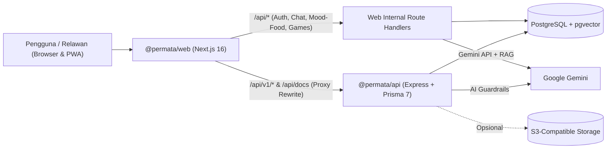

<div align="center">
  
  <h1>PERMATA</h1>
  <p>
    <strong>Platform Integrasi Pendidikan Resiliensi Mental &amp; Pendampingan Anak dalam Konteks Kebencanaan</strong>
  </p>
  <p>
    Ekosistem aplikasi web dan REST API berbasis kearifan lokal Nusantara (Aceh &amp; Sumatera Barat) untuk kesiapsiagaan bencana, respons darurat psikososial (<em>Psychological First Aid</em>), serta pertumbuhan pascatrauma (<em>Post-Traumatic Growth</em>).
  </p>

  <p>
    
    
    
    
    
    
    
  </p>

  <p>
    <a href="#arsitektur-sistem">Arsitektur</a> &bull;
    <a href="#fitur-utama">Fitur Utama</a> &bull;
    <a href="#memulai-di-lokal">Memulai di Lokal</a> &bull;
    <a href="#daftar-perintah">Perintah</a> &bull;
    <a href="#deployment-ke-vercel">Deployment</a> &bull;
    <a href="GUIDE.md">Panduan Lengkap</a>
  </p>
</div>

---

## Tentang PERMATA

**PERMATA** dirancang sebagai ruang aman digital untuk mendampingi anak, keluarga, dan relawan dalam menghadapi fase pra-bencana, tanggap darurat, hingga pemulihan jangka panjang. Aplikasi menggabungkan pendekatan psikososial modern dengan nilai kearifan lokal **Aceh** (_Meuseuraya_ / _Saweu Syedara_) dan **Sumatera Barat** (_Mambangkik Batang Tarandam_ / _Badunsanak_).

Repositori ini dikelola sebagai **Turborepo Monorepo** menggunakan **pnpm** (`apps/web`, `apps/api`, dan shared packages di `packages/*`).

---

## Arsitektur Sistem



---

## Fitur Utama

### Aplikasi Web (`apps/web`)

| Modul                          | Rute                      | Ringkasan Kemampuan                                                                                                                                       |
| :----------------------------- | :------------------------ | :-------------------------------------------------------------------------------------------------------------------------------------------------------- |
| **Geo-Cultural Tagging**       | Global (`CultureContext`) | Penyesuaian tema visual, istilah budaya, dan konteks refleksi antara **Aceh** dan **Sumatera Barat**.                                                     |
| **Dashboard &amp; Hope Tree**  | `/`, `/dashboard`         | Pusat progres **Hope Tree** (Pohon Harapan), target harian (_daily goals_ &amp; XP), dan navigasi modul pemulihan.                                        |
| **Autentikasi &amp; Akun**     | `/login`, `/register`     | Registrasi, login, dan sesi pengguna melalui `/api/auth/*`.                                                                                               |
| **Safety Passport**            | `/safety-passport`        | Kartu keselamatan darurat berisi kontak penting, anggota keluarga, titik kumpul, dan kebutuhan mendesak.                                                  |
| **Offline Survival &amp; PWA** | `/offline-survival`       | Akses darurat luring tanpa login (`sw.js`, `manifest.webmanifest`): panduan keselamatan, prinsip PFA, _grounding_, daftar _go-bag_, dan ekspor HTML.      |
| **Jurnal Hikmah**              | `/jurnal`, `/journal`     | Ruang refleksi emosional harian, pelacakan aktivitas menenangkan (_breathing_ &amp; hidrasi), dan riwayat refleksi.                                       |
| **Tele-Screening DASS-21**     | `/tele-screening`         | Skrining mandiri menggunakan instrumen **DASS-21** dengan kategori tingkat keparahan dan rekomendasi tindak lanjut.                                       |
| **AI Support Companion**       | `/ai-companion`           | Asisten percakapan berbasis **Google Gemini** + **RAG (`pgvector`)** (`POST /api/chat`) lengkap dengan _guardrails_, deteksi krisis, dan fallback budaya. |
| **Mood + Food Analyzer**       | `/mood-food`              | Analisis multimodal foto makanan dan suasana hati berbasis **Google Gemini** (`POST /api/mood-food`) untuk melihat keterkaitan nutrisi &amp; emosi.       |

### Game Center Resiliensi (`apps/web`)

| Game                      | Rute                | Deskripsi Singkat                                                                                                           | Hadiah Harian &amp; Catatan                                                                                         |
| :------------------------ | :------------------ | :-------------------------------------------------------------------------------------------------------------------------- | :------------------------------------------------------------------------------------------------------------------ |
| **Sigap Bencana**         | `/game-quake`       | Jelajahi rumah berilustrasi dengan **Phaser 3**, pelajari 3 situasi keselamatan, dan rasakan simulasi guncangan yang bisa dimatikan. | Maks. **20 XP/hari** &bull; Keyboard/sentuh, pengurangan animasi &bull; [Walkthrough](GUIDE.md#walkthrough-sigap-bencana) |
| **Tas Siaga Bencana**     | `/game-healing`     | Tutorial dialog Aira, pilih atau seret 6 perlengkapan ke tas, lalu selesaikan latihan santai atau tantangan 60 detik. | **20 XP/hari** &bull; Sentuh, mouse, atau kamera tangan opsional &bull; [Walkthrough](GUIDE.md#walkthrough-tas-siaga-bencana) |
| **Napas Tenang**          | `/game-breath`      | Latihan pernapasan terpandu dengan pilihan ritme, jeda/lanjutkan, serta mode cermin/deteksi kamera lokal opsional.          | Maks. **15 XP/hari** (dibagi dengan target napas dashboard) &bull; [Walkthrough](GUIDE.md#walkthrough-napas-tenang) |
| **Siaga Minang**          | `/game-siagaminang` | Petualangan Aira berlatar Minangkabau: 3 pos, 10 jenis perlengkapan, jembatan interaktif, dan kuis bersama Kak Naya menuju titik kumpul. | **20 XP/hari** &bull; Bintang pembelajaran, inventori edukatif, kontrol dua jari &bull; [Walkthrough](GUIDE.md#walkthrough-siaga-minang) |
| **Adventure Budaya**      | `/game-adventure`   | Simulasi naratif mitigasi bencana berbasis kearifan lokal.                                                                  | Modul edukasi interaktif                                                                                            |
| **Roleplay Psikoedukasi** | `/roleplay`         | Empat cerita bercabang dengan 7 karakter dan ekspresi untuk melatih empati, mendengarkan, serta mencari pendamping. | Tema Aceh/Kalimantan, mode tamu, jeda, napas/grounding, paket offline, dan maksimal **20 XP/hari** untuk akun login. |

> [!NOTE]
> Rute lama (`/PickAndDrop.html`, `/Breathing.html`, dan `/SiagaMinang.html`) otomatis mengarahkan pengguna ke halaman game di dalam aplikasi.

**Siaga Minang** terdiri dari **Kumpulkan Perlengkapan**, **Tantangan Jalur Aman**, dan **Misi Evakuasi**. Kak Naya tampil sebagai pendamping di checkpoint dan kartu kuis, mengenakan rompi hijau serta membawa papan catatan. Sepuluh perlengkapan mencakup air minum, makanan siap santap, P3K, senter, pengisi daya portabel, jas hujan, masker, selimut, peluit, dan radio. Kuis menjeda permainan dan dapat dicoba lagi; bintang diberikan berdasarkan pembelajaran. Jika jatuh, progres perlengkapan dan kuis tetap terjaga selama sesi.

Dalam **Roleplay Psikoedukasi**, pemain berperan sebagai **Aira** dan menemani **Rusdi**, **Cut**, **Evan**, serta **Lani**, dengan dukungan **Kak Naya** dan **Bu Sari**. Setiap cerita memakai karakter dan ekspresi sesuai situasinya. Potret roleplay dan ilustrasi Siaga Minang disertakan dalam paket offline.

Di **Sigap Bencana**, efek guncangan berhenti saat jeda atau pertanyaan terbuka dan mengikuti pengaturan pengurangan animasi perangkat. **Tas Siaga Bencana** menyediakan dialog bertahap serta narasi opsional. Kamera tangan tetap opsional dan memerlukan internet saat memuat model MediaPipe dari CDN.

### Layanan Backend API (`apps/api`)

- **Autentikasi, RBAC &amp; Persetujuan Orang Tua** (`/api/v1/auth`, `/api/v1/users`, `/api/v1/children`): JWT access + refresh token, hashing **Argon2id**, kontrol akses berbasis peran, dan _parental consent_.
- **Kesiapsiagaan Bencana** (`/api/v1/simulations`, `/api/v1/assessments`, `/api/v1/safety-passport`): Simulasi bercabang, asesmen pra/pasca-edukasi, dan paspor keselamatan keluarga.
- **Tanggap Darurat &amp; Offline Sync** (`/api/v1/disaster-incidents`, `/api/v1/support`, `/api/v1/offline`): Manajemen insiden, layanan _SafeConnect_ (PFA), paket konten luring, dan sinkronisasi antrean lapangan.
- **Pemulihan Jangka Panjang** (`/api/v1/recovery-journal`, `/api/v1/growth`, `/api/v1/care-circle`, `/api/v1/grief-journey`): Jurnal pemulihan dengan kontrol visibilitas, tonggak _Hope Tree_, kolaborasi _Care Circle_, dan adaptasi duka.
- **AI Guardrails, Analitik &amp; Tata Kelola** (`/api/v1/ai`, `/api/v1/dashboard`, `/api/v1/content`, `/api/v1/regions`, `/api/v1/media`, `/api/v1/organizations`, `/api/v1/admin`, `/api/v1/audit`).
- **Dokumentasi &amp; Health Check**: Swagger UI di `/api/docs` (JSON di `/api/docs.json`) serta status server di `/health` dan `/api/v1/health`.

---

## Tech Stack

| Lapisan                    | Teknologi                                                                                                                        |
| :------------------------- | :------------------------------------------------------------------------------------------------------------------------------- |
| **Monorepo &amp; Tooling** | pnpm (`12.18.0`), Turborepo, TypeScript, ESLint, Prettier                                                                        |
| **Frontend (`apps/web`)**  | Next.js 16 (App Router), React 19, Tailwind CSS v4, Framer Motion, Lucide React, Phaser 3, OGL, PWA Service Worker               |
| **Backend (`apps/api`)**   | Express.js, Prisma 7 (`@prisma/adapter-pg`), Zod, Argon2, JWT, Helmet, Rate Limiter, Winston, Swagger (`swagger-jsdoc` &amp; UI) |
| **Database &amp; Storage** | PostgreSQL (`pg`, `@neondatabase/serverless`, ekstensi `pgvector`), S3-compatible / `files-sdk`                                  |
| **AI &amp; RAG**           | Google Gemini (`@google/generative-ai`, default `gemini-2.5-flash` &amp; `gemini-embedding-001`)                                 |
| **Testing**                | Vitest &amp; Supertest (`apps/api/tests`), Node.js Test Runner (`apps/web/tests`)                                                |

---

## Struktur Monorepo

<details>
<summary>Klik untuk melihat struktur direktori lengkap</summary>

```text
permata-apps-new/
├── apps/
│   ├── web/                          # Aplikasi Frontend Next.js 16 (@permata/web)
│   │   ├── public/                   # Aset statis, audio, tiles Phaser, manifest & sw.js
│   │   ├── src/
│   │   │   ├── app/                  # Halaman App Router & API Route Handlers Next.js
│   │   │   ├── components/           # Komponen halaman, UI kit, Navbar, OfflineRuntime
│   │   │   ├── context/              # AuthContext & CultureContext (Aceh / Sumbar)
│   │   │   ├── data/                 # Data instrumen DASS-21 & konten Offline Survival
│   │   │   ├── game/                 # Konfigurasi & scene Phaser 3
│   │   │   ├── lib/                  # Utilitas DB, auth sesi, AI guardrails, storage, offline cache
│   │   │   └── utils/                # Helper API & kalkulasi skor DASS-21
│   │   ├── tests/                    # Tes logika game & cache offline (Node test runner)
│   │   └── next.config.ts            # Konfigurasi Next.js & proxy rewrite ke backend API
│   └── api/                          # Layanan Backend Express (@permata/api)
│       ├── prisma/
│       │   ├── schema.prisma         # Skema database PostgreSQL (Prisma 7)
│       │   ├── migrations/           # Migrasi skema & penyimpanan sesi game
│       │   └── seed.ts               # Data awal peran (roles), jenis bencana, dll.
│       ├── scripts/
│       │   └── prepare-vercel.cjs    # Bundling backend untuk deployment Vercel Services
│       ├── src/
│       │   ├── common/               # Error types, response helpers, tipe bersama
│       │   ├── config/               # Env validation, database, logger, storage
│       │   ├── middlewares/          # Auth, rate limiter, request ID, validation, error handler
│       │   ├── modules/              # Modul fitur REST API (/api/v1/*)
│       │   ├── app.ts                # Konfigurasi Express & Swagger
│       │   └── server.ts             # Entrypoint server HTTP
│       └── tests/                    # Unit & integration tests (Vitest + Supertest)
├── packages/
│   ├── ui/                           # Shared UI library (@permata/ui)
│   └── config-tailwind/              # Shared Tailwind config (@permata/config-tailwind)
├── docs/
│   ├── rag/                          # Korpus pengetahuan terkurasi untuk RAG chat web
│   ├── AI_Rules.txt                  # Panduan & guardrails AI
│   └── PRD Permata.md                # Dokumen kebutuhan produk
├── scripts/
│   └── rag-index.mjs                 # Indeks idempotent korpus RAG ke pgvector (pnpm rag:index)
├── .env.example                      # Template environment variables monorepo
├── compose.dev.yml                   # PostgreSQL (pgvector) & pgAdmin lokal via Docker
├── pnpm-workspace.yaml               # Definisi workspace pnpm
├── turbo.json                        # Pipeline task Turborepo
├── vercel.json                       # Konfigurasi deployment 1 proyek Vercel Services
└── package.json                      # Skrip root monorepo
```

</details>

---

## Memulai di Lokal

### Prasyarat

- **Node.js** `22 LTS` (minimum `>=18`, disarankan `22` untuk Next.js 16 dan Prisma 7)
- **pnpm** `12.x` (`packageManager: pnpm@12.18.0`)
- **PostgreSQL** (disarankan dengan ekstensi `pgvector` untuk RAG, atau PostgreSQL lokal / Neon)
- **Google Gemini API Key** (untuk fitur AI Companion, RAG embedding, dan Mood + Food Analyzer)

### 1. Clone &amp; Instalasi Dependensi

```bash
git clone https://github.com/airlanggapradana/permata-apps-new.git
cd permata-apps-new
pnpm install
```

### 2. Konfigurasi Database Lokal (Opsional via Docker)

Jika belum memiliki PostgreSQL lokal dengan `pgvector`, jalankan container pengembangan yang sudah disediakan di [`compose.dev.yml`](compose.dev.yml):

```bash
docker compose -f compose.dev.yml up -d
```

Layanan yang aktif:

- **PostgreSQL (`pgvector/pgvector:pg18`)**: `127.0.0.1:5432` (user/pass/db: `postgres` / `postgres` / `permata`)
- **pgAdmin**: `http://localhost:5050` (`admin@permata.com` / `admin`)

### 3. Konfigurasi Environment Variables

Salin file template sesuai workspace:

- **Frontend (`apps/web`)**: salin [`apps/web/.env.example`](apps/web/.env.example) menjadi `apps/web/.env.local`
- **Backend (`apps/api`)**: salin [`apps/api/.env.example`](apps/api/.env.example) menjadi `apps/api/.env`
- **Root (referensi umum)**: lihat [`.env.example`](.env.example)

<details>
<summary>Lihat daftar variabel environment utama</summary>

| Variabel                                                  | Lokasi                                         | Keterangan                                                                                                     |
| :-------------------------------------------------------- | :--------------------------------------------- | :------------------------------------------------------------------------------------------------------------- |
| `DATABASE_URL`                                            | `apps/api/.env` &amp; `apps/web/.env.local`    | Connection string PostgreSQL (samakan port lokal, misalnya `5432` atau `5433`)                                 |
| `AUTH_SESSION_SECRET`                                     | `apps/web/.env.local`                          | Secret acak minimal 32 karakter untuk menandatangani sesi login web                                            |
| `ACCESS_TOKEN_SECRET`                                     | `apps/api/.env`                                | Secret JWT access token minimal 32 karakter                                                                    |
| `REFRESH_TOKEN_SECRET`                                    | `apps/api/.env`                                | Secret JWT refresh token minimal 32 karakter                                                                   |
| `GEMINI_API_KEY`                                          | `apps/web/.env.local`                          | API key Google Gemini untuk rute `/api/chat` &amp; `/api/mood-food`                                            |
| `AI_PROVIDER` / `AI_API_KEY` / `AI_MODEL`                 | `apps/api/.env`                                | Konfigurasi AI backend (`gemini`, API key, `gemini-2.5-flash`)                                                 |
| `NEXT_PUBLIC_API_URL` / `BACKEND_API_URL`                 | `apps/web/.env.local`                          | Opsional di lokal; saat development `next.config.ts` otomatis mem-proxy `/api/v1/*` ke `http://localhost:4000` |
| `RAG_EMBEDDING_MODEL` / `RAG_EMBEDDING_DIM` / `RAG_TOP_K` | `.env`, `apps/web/.env.local`, `apps/api/.env` | Konfigurasi RAG AI Companion (default `gemini-embedding-001`, `768`, `4`)                                      |

</details>

### 4. Setup Skema Database &amp; Indeks RAG

```bash
# Generate Prisma Client, terapkan migrasi, dan isi data awal
pnpm db:generate
pnpm db:deploy
pnpm db:seed

# (Opsional, membutuhkan pgvector & GEMINI_API_KEY) Indeks korpus docs/rag/
pnpm rag:index
```

> [!TIP]
> Gunakan `pnpm db:migrate` jika sedang membuat migrasi development secara bertahap. Untuk `pnpm rag:index`, perintah bersifat _idempotent_; bila tabel `pgvector` belum tersedia, fitur chat tetap berjalan dengan fallback aman tanpa konteks RAG.

### 5. Menjalankan Aplikasi

```bash
# Menjalankan seluruh workspace secara paralel via Turborepo
pnpm dev
```

Atau jalankan masing-masing secara terpisah:

```bash
pnpm --filter @permata/web dev    # Frontend Next.js (http://localhost:3000)
pnpm --filter @permata/api dev    # Backend Express API (http://localhost:4000)
```

Setelah berjalan, layanan dapat diakses di:

- **Frontend Web**: `http://localhost:3000`
- **Backend API**: `http://localhost:4000`
- **Swagger API Docs**: `http://localhost:4000/api/docs` (atau `http://localhost:3000/api/docs`)

---

## Daftar Perintah

| Perintah                               | Fungsi                                                    |
| :------------------------------------- | :-------------------------------------------------------- |
| `pnpm dev`                             | Menjalankan dev server semua workspace melalui Turborepo  |
| `pnpm --filter @permata/web dev:turbo` | Menjalankan frontend Next.js dengan Turbopack             |
| `pnpm build`                           | Build seluruh package dan aplikasi dalam monorepo         |
| `pnpm lint`                            | Menjalankan linter di seluruh workspace                   |
| `pnpm test`                            | Menjalankan test suite melalui Turborepo (`@permata/api`) |
| `pnpm format`                          | Memformat kode `.ts`, `.tsx`, dan `.md` dengan Prettier   |
| `pnpm db:generate`                     | Generate Prisma Client pada `@permata/api`                |
| `pnpm db:migrate`                      | Menjalankan `prisma migrate dev` pada `@permata/api`      |
| `pnpm db:push`                         | Sinkronisasi skema Prisma ke database (`prisma db push`)  |
| `pnpm db:deploy`                       | Menerapkan migrasi produksi (`prisma migrate deploy`)     |
| `pnpm db:seed`                         | Mengisi data awal database melalui `prisma/seed.ts`       |
| `pnpm rag:index`                       | Mengindeks korpus `docs/rag/` ke `pgvector` (idempotent)  |

---

## Pengujian (Testing)

```bash
# Backend unit & integration tests (Vitest + Supertest di apps/api/tests/)
pnpm test
# atau langsung pada workspace API:
pnpm --filter @permata/api test

# Frontend: tes logika, API dengan dependensi tiruan, dan cache offline
# Tidak membutuhkan server aplikasi atau koneksi database
pnpm --filter @permata/web test:minang
pnpm --filter @permata/web test:bag-camera
pnpm --filter @permata/web test:roleplay
pnpm --filter @permata/web test:offline

# Frontend: suite game termasuk integrasi dan integrasi roleplay
# Membutuhkan frontend serta PostgreSQL lokal yang sudah berjalan
pnpm --filter @permata/web test:game
pnpm --filter @permata/web test:roleplay:integration
```

Tes Siaga Minang mencakup jalur yang bisa ditamatkan, checkpoint, interaksi jembatan, percobaan ulang kuis, validasi versi sesi, dan batas hadiah harian. Tes kamera Tas Siaga memeriksa penghentian tracker saat pemrosesan masih aktif, pemanggilan penutupan berulang, dan kegagalan inisialisasi. Tes offline memastikan ilustrasi permainan tersedia setelah paket diunduh.

Tes integrasi web membaca konfigurasi dari `apps/web/.env.local`. Gunakan `PERMATA_TEST_BASE_URL` dan `PERMATA_TEST_DATABASE_URL` untuk mengganti alamat aplikasi dan database pengujian; keduanya harus menunjuk ke layanan lokal.

---

## Deployment ke Vercel

Repositori ini dikonfigurasi untuk men-deploy **Frontend (`apps/web`)** dan **Backend (`apps/api`)** dalam **satu proyek Vercel** melalui **Vercel Services** pada [`vercel.json`](vercel.json):

- **Service `frontend` (`apps/web`)**: Melayani halaman Next.js serta API internal (`/api/chat`, `/api/mood-food`, `/api/auth/*`, dll.) dan terhubung ke backend melalui _service binding_ `BACKEND_INTERNAL_URL`.
- **Service `backend` (`apps/api`)**: Dibundle oleh [`apps/api/scripts/prepare-vercel.cjs`](apps/api/scripts/prepare-vercel.cjs) untuk melayani endpoint `/api/v1/*`, `/api/docs`, `/api/docs.json`, dan `/health`.

> [!IMPORTANT]
> Saat mengimpor repositori ke **Vercel Dashboard**, biarkan **Root Directory** tetap pada root (`.`) agar konfigurasi `vercel.json` dan workspace monorepo terbaca dengan benar.

Pastikan Environment Variables berikut telah diatur di pengaturan proyek Vercel sebelum deploy (`vercel --prod`):

- `DATABASE_URL`
- `AUTH_SESSION_SECRET` (minimal 32 karakter)
- `ACCESS_TOKEN_SECRET` (minimal 32 karakter)
- `REFRESH_TOKEN_SECRET` (minimal 32 karakter)
- `GEMINI_API_KEY`
- `AI_PROVIDER=gemini`, `AI_API_KEY`, dan `AI_MODEL=gemini-2.5-flash`

---

## Dokumentasi Terkait

- [`GUIDE.md`](GUIDE.md) — Panduan penggunaan fitur antarmuka web, walkthrough game, serta modul backend.
- [`docs/PRD Permata.md`](docs/PRD%20Permata.md) — Dokumen _Product Requirements_ sistem PERMATA.
- [`docs/AI_Rules.txt`](docs/AI_Rules.txt) — Panduan dan _guardrails_ perilaku AI.
- Referensi aset permainan: [Tas Siaga](docs/emergency-bag-assets.txt), [Sigap Bencana](docs/sigap-bencana-assets.txt), [Siaga Minang](docs/siaga-minang-assets.txt), [Kak Naya](docs/siaga-minang-naya-assets.txt), dan [karakter roleplay](docs/roleplay-character-assets.txt).
- [`packages/ui`](packages/ui) &amp; [`packages/config-tailwind`](packages/config-tailwind) — Paket UI dan konfigurasi Tailwind bersama.
